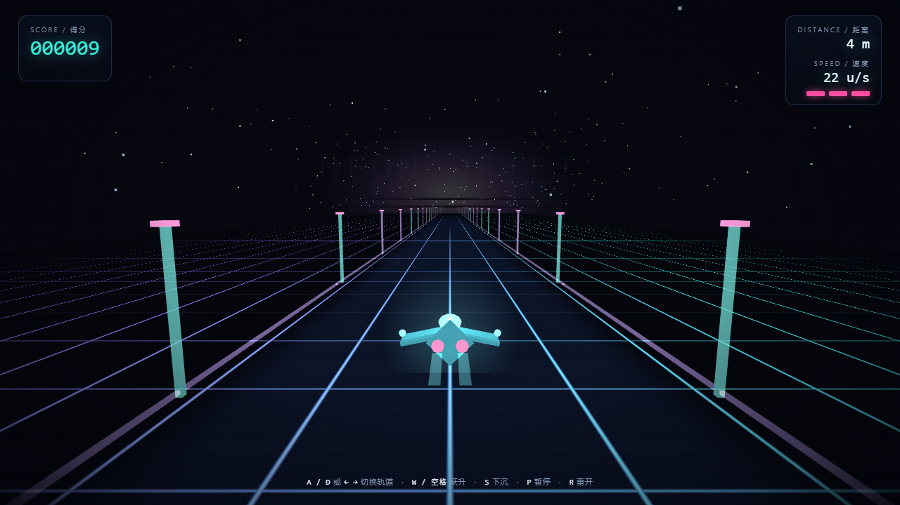

# NEON DRIFT — 3D 游戏作品

一个**从零搭建、不依赖任何外部美术资源**的三轨道无尽飞行 3D 游戏原型。
赛道、飞船、障碍、UI、地面着色器全部由代码生成；同一套玩法提供 **Unity 工程** 与 **浏览器镜像版** 两份实现。



> `docs/preview.svg` 是同一画面的纯文本 SVG 示意图，便于在不支持 PNG 预览的环境里查看。

| | Unity 工程 | 浏览器镜像版 |
|---|---|---|
| 用途 | 面试展示主交付物：源码、架构、Shader | 零安装现场演示 / 录屏 / 发链接 |
| 引擎 | 团结引擎 2022.3.62t18 / Unity 2021.3 LTS 及以上 | Three.js（已本地化，无需联网） |
| 入口 | `unity/`（完整工程，Cowork 直接打开） | `web/showcase.html`（单文件展示页） |

---

## 一、快速开始

### A. 浏览器版（30 秒就能演示）

直接双击 `web/index.html`（模块化开发版）。

**面试首选：`web/showcase.html`** —— 单文件、离线、双击即开。左侧是可玩的 3D 游戏，
右上角「作品讲解」展开后是架构图、四个技术亮点、**工程里的真实 C# / Shader 源码片段**
与高频追问要点。不需要 Unity、不需要联网，可直接当邮件附件发给面试官；
打开讲解面板时游戏自动暂停，按 `F2` / `Esc` 或面板右上角 `×` 关闭后继续。

**只要纯游戏画面时用 `web/standalone.html`**：它把运行库和全部源码内联成一个
640 KB 的 HTML 文件，单文件、离线、双击即玩，同样可以直接当邮件附件或网盘链接发出去，
对方不需要装任何东西、也不需要联网。

若浏览器对本地文件有限制，起一个本地服务：

```bash
cd web
python -m http.server 8080
# 打开 http://localhost:8080
```

`web/vendor/three.min.js` 已下载到本地，**完全离线可运行**。

### B. Unity / 团结引擎工程（面试主交付物）

`unity/` **已经是一个完整、可直接打开的工程**（含 `Assets/`、`Packages/manifest.json`、
`ProjectSettings/`，设置取自团结引擎官方 3D 模板）。
**一步一步照着 [`START-HERE.md`](START-HERE.md) 点即可**：

1. 团结 Cowork → **打开已有项目** → 选 `neon-drift\unity` 这一层文件夹（不是 `Assets`）。
2. 首次打开等 1–3 分钟导入完成；`ProjectVersion.txt` 已锁定 `2022.3.62t18`。
3. 双击 `Assets/Scenes/NeonDrift.unity`（已烘焙好的 16 段赛道场景）→ 点 **▶ Play** → 按 `Enter` 开始。
4. `Ctrl+Shift+C` 看 Console 无红色报错。

也保留原来的用法：把 `unity/Assets` 整体拷进任意 3D 工程，**打开任意场景直接点 Play**
就能跑 —— `GameBootstrap.cs` 用 `[RuntimeInitializeOnLoadMethod]` 自动搭建整个世界，
无需拖预制体、无需配场景和 UI。想在 Scene 视图看到可编辑赛道，菜单
**Tools > Neon Drift > Bake Environment Scene**；本工程已烘焙好，不必再执行。

可选：菜单 **Create > Neon Drift > Game Config** 创建配置资源，命名为 `NeonDriftConfig.asset`
并放进任意 `Resources` 目录，游戏会自动读取覆盖默认参数。

> `Packages/manifest.json` 只依赖引擎内置模块 + `com.unity.ugui`，**完全离线**；
> 其中 `physics` / `audio` / `particlesystem` 三个模块是 `WorldBuilder.cs` 必需的，别删。
> Active Input Handling 设为 `Both` / `Input Manager (Old)` / 新 Input System 均可，
> `NDInput.cs` 内做了条件编译适配。

### 操作

| 按键 | 动作 |
|---|---|
| `A` / `D`、`←` / `→`、左右滑动 | 切换轨道 |
| `W` / `↑` / `空格`、上滑 | 跃升，躲地面方块 |
| `S` / `↓`、下滑 | 下沉，躲低空横梁 |
| `P` / `Esc` | 暂停 |
| `R` | 重开 |
| `Enter` / `空格` / 点击 | 开始 |

红色方块要变轨或跳过，橙色横梁要下沉，青色晶体加分并维持连击；三点护盾耗尽即结束。

### C. 引擎曾经打不开（现已解决）

团结引擎 `2022.3.62t18` 曾卡在 `License error`：`Editor.log` 报
`No valid Unity Editor license found` —— 根因是**只装了编辑器离线包、没装负责签发
许可证的团结 Cowork**，也没在里面登录 Unity 中国账号。硬件（RTX 4060 + 780M）、
系统（Win11）与 .NET 4.8 均正常。完整诊断与激活步骤保留在
[`ENGINE-FIX.md`](ENGINE-FIX.md)。

**17:41 许可证已激活，17:52 已用引擎实机编译通过并烘焙好场景**。
现在按 B 节 / [`START-HERE.md`](START-HERE.md) 直接打开工程即可。

即便现场不方便开引擎，`web/showcase.html` 也能承担全部演示：

| 要证明什么 | 用展示页怎么做 |
|---|---|
| 东西能跑 | 左侧直接玩一局：`A/D/W/S` 变轨跃升、HUD 计分、护盾、暂停与重开都是实时的 |
| 架构讲得清 | 讲解面板 02 节的架构图，从启动入口到四个子系统一目了然 |
| 代码不是空谈 | 03 节六段源码**直接从 `unity/Assets` 读取**，C# 与 Shader 均为真实内容，非伪代码 |
| 追问不露怯 | 05 节五条高频追问的回答骨架，06 节如实说明的边界 |

`unity/` 已是完整工程，实机编译与场景烘焙均已完成（见 B 节与 `START-HERE.md`）；
展示页仍是最稳的现场兜底。

---

## 二、目录结构

```
neon-drift/
├── START-HERE.md              ★ 在团结引擎里运行：一步一步照着点
├── README.md                  本文件
├── INTERVIEW.md               面试讲稿 + 高频追问 + 演示清单
├── ENGINE-FIX.md              团结引擎打不开：诊断与激活（问题已解决）
├── docs/
│   ├── preview.png            游戏实机渲染截图
│   └── showcase.png           展示页（游戏 + 讲解面板）实机截图
├── web/                       浏览器镜像版
│   ├── index.html             页面 + CSS HUD（模块化开发版）
│   ├── standalone.html        单文件离线游戏版（可直接发送）
│   ├── showcase.html          ★ 单文件面试展示页（游戏 + 讲解 + 真实源码）
│   ├── showcase-panel.html    展示页讲解面板模板（构建输入）
│   ├── vendor/three.min.js    本地 Three.js（r149，UMD）
│   └── src/
│       ├── config.js          全局可调参数（对应 Unity 的 GameConfig）
│       ├── pool.js            泛型对象池
│       ├── world.js           世界 / 自研 GLSL 网格 Shader / 资源工厂
│       ├── player.js          玩家状态机
│       ├── game.js            主控制器：状态机 / 生成 / 碰撞 / 计分
│       └── main.js            渲染器与输入层
├── unity/                      ★ 完整团结引擎工程（Cowork 直接打开这一层）
│   ├── README.md                  Unity 工程单独交付时的说明
│   ├── Packages/manifest.json     仅依赖内置模块 + ugui（完全离线）
│   ├── ProjectSettings/          取自团结引擎官方 3D 模板
│   └── Assets/
│       ├── Scripts/               12 个 C# 运行时脚本
│       ├── Shaders/NeonGrid.shader 自写霓虹网格地面 Shader
│       ├── Editor/SceneBuilder.cs  烘焙可编辑场景的编辑器工具
│       ├── Scenes/NeonDrift.unity  ★ 已烘焙好的 16 段赛道场景
│       └── NeonDrift/Materials/    烘焙落盘的 6 个材质
└── tests/
    ├── smoke.js                Node 逻辑冒烟测试
    ├── check_sources.py        C# / Shader / 资源静态校验
    ├── bundle.js               生成单文件离线游戏版
    ├── build_showcase.js       生成单文件面试展示页（内嵌真实源码片段）
    └── probe.js                浏览器渲染自检页面生成器
```

---

## 三、架构与关键设计

**装配方式**：`GameManager` 是唯一入口，通过构造参数把 `GameConfig`、`WorldRefs`、
`PlayerController` 注入各子系统，不使用全局单例；`WorldRefs` 让「运行时自动搭建」和
「编辑器烘焙场景」两条路径共用同一套环境代码。

**状态机**：`Ready → Playing ⇄ Paused → Over → Playing`。UI、输入、世界动画都按状态分流，
暂停时不推进任何游戏逻辑。

**程序化生成**：按**行进距离**而不是时间触发生成（`spawnAccum += speed * dt`），
因此速度从 22 提升到 48 时障碍间距依然一致。每行随机占用 1~2 条轨道，
**永远保留至少一条空轨道**，并把晶体放在这条安全路径上 —— 这是关卡「可解性」的保证。
难度随距离线性插值：速度上升、间距缩小、双障碍概率提高。

**对象池**：障碍与晶体整局复用，避免 `Instantiate` / `Destroy` 产生的 GC 峰值。
`Active` 列表倒序遍历，回收时用 `RemoveAt`，保证遍历安全。低频的拾取/受击特效才用
`ParticleSystem` + 定时销毁 —— 这是有意的性能取舍。

**碰撞**：没有用 Collider / 物理引擎，而是自己算 AABB 重叠。每次更新记录移动前的 z，
当物体**跨过玩家平面 z=0** 时结算一次。这是扫掠判定：即使 48 单位/秒 + 低帧率导致
单帧位移 2.4 单位，也不会从碰撞窗口里「穿过去」。判定用实际 x 坐标而非轨道编号，
变轨插值途中不会出现「明明看着躲开了却算撞」的情况。

**帧率无关**：所有位移按 `dt` 积分，`dt` 上限 0.05s 防止切后台回来后瞬移；
横向移动用 `1 - exp(-k·dt)` 指数插值，30 / 60 / 144 Hz 手感一致。

**渲染**：地面网格是一张静止的 Plane，靠自写 Shader 用**世界坐标**计算网格线，
脚本只推 `_Scroll` 一个 uniform，几何体完全不移动。Shader 的 Pass 打
`SRPDefaultUnlit` 标签，Built-in / URP / HDRP 都能渲染。护栏分段循环复用，
超出相机后整体回卷，场景中始终只有 16 段。

**输入适配**：`NDInput` 用条件编译同时兼容旧 Input Manager 与新 Input System，
把键盘、鼠标拖拽、触屏滑动归一成四种动作，玩法层不感知平台差异。

**数据驱动**：所有数值集中在 `GameConfig`（ScriptableObject）/ `config.js`，
调难度不用改逻辑代码。

---

## 四、自检（已在本机执行）

```bash
node tests/smoke.js            # 逻辑冒烟：11 项全部 PASS
python tests/check_sources.py  # C# / Shader / 资源引用：45 项全部 PASS
node tests/bundle.js           # 重新生成单文件游戏版 web/standalone.html
node tests/build_showcase.js   # 重新生成单文件展示页 web/showcase.html
node tests/probe.js --showcase # 生成展示页渲染自检页面
```

浏览器版（模块化版、单文件游戏版、单文件展示页）均已用无头 Edge 真实渲染验证：
**0 个 JS 错误**，画布 1250×578 / 1410×758，状态 `playing`、计分正常。
展示页还额外验证了讲解面板可展开/关闭、关闭后游戏自动恢复 `playing`、
6 段源码片段全部就位。`docs/preview.png` 是游戏实机截图，
`docs/showcase.png` 是展示页实机截图。

> **验证状态（如实说明）**：本机团结引擎 `2022.3.62t18` 许可证已激活，并用引擎批处理模式
> 完成了**真实编译**：0 error，生成 `Assembly-CSharp.dll` / `Assembly-CSharp-Editor.dll`；
> `SceneBuilder.Bake` 也已实机执行成功，产出 `Assets/Scenes/NeonDrift.unity`（16 段环境）
> 与 6 个 `.mat` 材质。浏览器版另经无头 Edge 真实渲染验证。
>
> **尚未做的是 Play 模式实机试玩** —— 请按 [`START-HERE.md`](START-HERE.md) 点一次 Play、
> 玩到一次 Game Over、确认 Console 无红色报错。这一步必须你亲手做，也是面试讲清
> 运行表现的前提。别编 Profiler 数据或实机截图，没有就直说。
>
> 工程里的 `Packages/manifest.json` 曾因漏声明 `physics` / `audio` / `particlesystem`
> 内置模块导致 `CS1069`，现已按官方 3D 模板补全 33 个模块；换用其他 Unity 版本时
> 兼容点已用 `#if UNITY_2022_2_OR_NEWER` 等条件编译处理。

---

## 五、关于作品归属

这份工程是在本轮面试准备中、借助 AI 工具从零生成的。**面试时请如实表述**：
可以说「这是我为准备面试在工具辅助下完成、并且已经跑通和理解的原型」，
不要说成「过去独立负责的商业项目」。面试官真正在考察的是你能不能解释清楚
每一个设计决策 —— 具体怎么准备，见 `INTERVIEW.md`。

---

## 六、许可与依赖

- 全部 C# / GLSL / JS 代码与文档为本作品原创，可自由用于学习、演示与作品集。
- `web/vendor/three.min.js` 为 Three.js r149（MIT License），仅用于浏览器镜像版。
